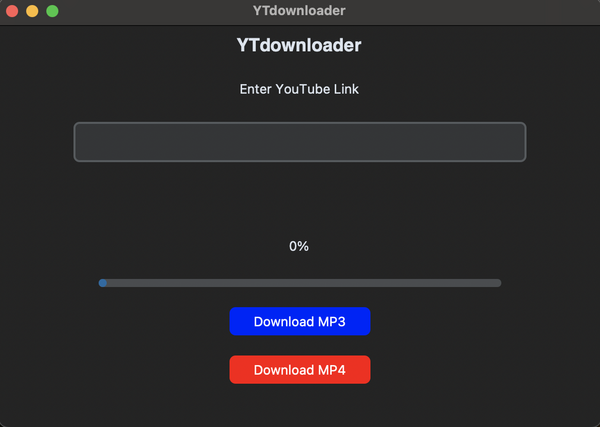
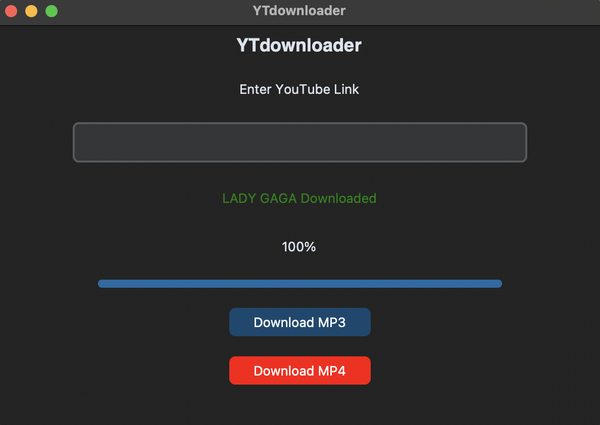

# YTdownloader: Desktop YouTube Downloader

A modern, cross-platform desktop application designed for seamless downloading of YouTube content. Built with **Python** and featuring a sleek **CustomTkinter** GUI, this tool allows users to easily save their favorite videos as high-quality `.mp3` or `.mp4` files.

## 🚀 Key Features

- **Intuitive GUI**: A clean, user-friendly interface built with `customtkinter` for a modern look and feel.
- **High-Quality Extraction**: 
  - **Audio (MP3)**: Extracts audio at 192kbps for crystal-clear sound.
  - **Video (MP4)**: Merges best video and audio streams for the highest available resolution.
- **Background Orchestration**: Leverages the power of `yt-dlp` and `FFmpeg` for robust and reliable processing.
- **Cross-Platform Support**: Includes specialized instructions and builds for both **Windows** and **macOS**.
- **Automated Organization**: Automatically categorizes downloads into dedicated `YTD_Audios` and `YTD_videos` directories.

## 🛠️ Tech Stack

- **Language**: Python 3
- **GUI Framework**: [CustomTkinter](https://github.com/TomSchimansky/CustomTkinter)
- **Processing Engine**: [yt-dlp](https://github.com/yt-dlp/yt-dlp)
- **Multimedia Framework**: [FFmpeg](https://ffmpeg.org/)
- **Build Tools**: [PyInstaller](https://pyinstaller.org/), [py2app](https://github.com/ronaldoussoren/py2app)

## 📋 Prerequisites

- Python 3.9+
- **FFmpeg** must be installed and added to your system's PATH.

## ⚙️ Installation & Running

1. **Clone the repository:**
   ```bash
   git clone https://github.com/daniel1wnl/YTdownloader.git
   cd YTdownloader
   ```

2. **Create and activate a virtual environment:**
   - **Unix/macOS:**
     ```bash
     python3 -m venv env
     source env/bin/activate
     ```
   - **Windows:**
     ```bash
     py -m venv env
     .\env\Scripts\activate
     ```

3. **Install dependencies:**
   ```bash
   pip install -r requirements.txt
   ```

4. **Run the application:**
   ```bash
   python YTdownloader.py
   ```

## 📦 Download Binaries

For users who prefer a standalone application without installing Python, check out the [Latest Releases](https://github.com/daniel1wnl/YTdownloader/releases) for `.app` (macOS) and `.exe` (Windows) files.

## 📸 Previews

### Application Interface (macOS)


### Download Success


## 👤 Author

**Daniel Gregorio-Torres**
- [GitHub](https://github.com/daniel1wnl)
- [LinkedIn](https://www.linkedin.com/in/danielgregoriotorres/)
